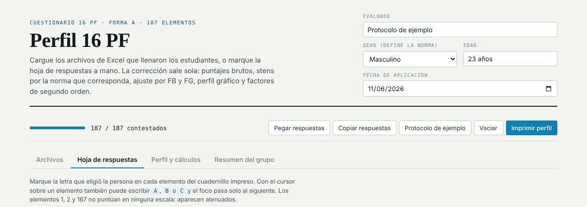
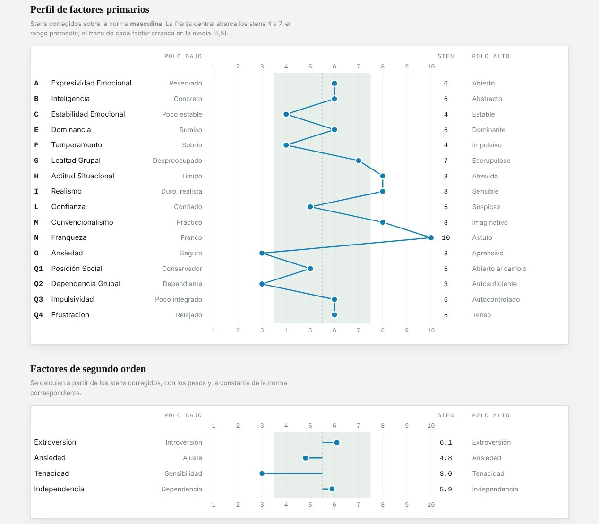

# Perfil 16 PF

**Corrector web del cuestionario 16 PF (Forma A, 187 elementos).** Se cargan las hojas de respuestas en Excel o se marcan a mano, y la corrección sale sola: puntajes brutos, conversión a stens según la norma, ajuste por las escalas de validez, perfil gráfico y factores de segundo orden.

> Este repositorio es una vitrina del proyecto. El código fuente es privado y el sitio publicado tiene acceso restringido, porque trabaja con material del manual del 16 PF que es de uso profesional. Las capturas usan el protocolo de ejemplo de la app.

## Por qué existe

Reemplaza un libro de Excel con el que se corregía a mano. Los resultados se verificaron contra ese archivo y coinciden sin diferencias: puntajes brutos, stens, stens corregidos, escalas de validez y factores de segundo orden.

## Qué hice

- Corrección automática en el navegador, sin servidor: los datos de las personas evaluadas no salen de la computadora.
- Carga de varios archivos de Excel a la vez (con SheetJS) y resumen del grupo.
- Perfil gráfico de factores primarios y de segundo orden, listo para imprimir.
- Acceso restringido con Cloudflare Access, solo para las profesionales que lo usan.

## Stack

`JavaScript` `HTML` `CSS` `SheetJS` `Cloudflare Pages` `Cloudflare Access`

---

Hecho por [Andrea Soteldo](https://andrea-soteldo.pages.dev)
